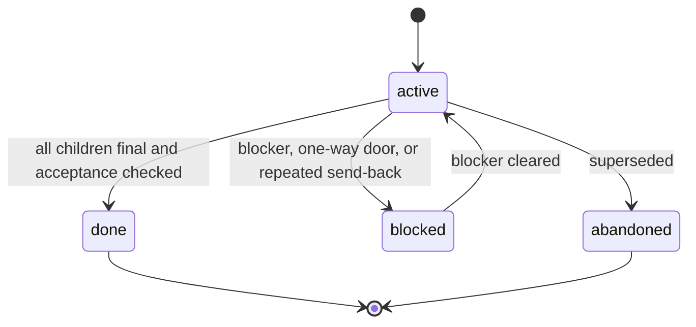

<!-- SPDX-License-Identifier: CC-BY-4.0 -->

# State machines

Status: 2026-11-15, LibreHarness task queue and goal, commit 943d7a5.
Residual risks: the queue lock and the worktree reaper have not been audited
under concurrent failure.

The `state-audit` skill maintains this file. Each machine has one section, a
Mermaid statechart from the user's point of view, and a findings table.

## Findings

| ID | Machine | Invalid path | Impact | Evidence | Status | Test |
|---|---|---|---|---|---|---|
| _none yet_ | | | | | | |

## Task queue

- Owner: `bin/tasks.py`; state is the `status` field in each task file.
- Kind: explicit.
- States: `inbox`, `ready`, `active`, `review`, `done`, `blocked`,
  `abandoned`.
- Invariants:
  - a ready or inbox task can be claimed; a blocked task only with `--force`;
  - dependencies must be final unless `--force`;
  - one owner and one lane per active task;
  - `done` requires recorded evidence;
  - `review` means the review passed and the task awaits integration or close.
- Transitions:

| From | Event / guard | To | Side effects |
|---|---|---|---|
| inbox | scope confirmed | ready | acceptance checked |
| inbox | `claim`, dependencies final | active | owner, branch, worktree set |
| ready | `claim` with dependencies final | active | owner, branch, worktree set |
| blocked | `claim --force` | active | reason cleared, owner set |
| active | review passed | review | verdict logged |
| review | close with evidence | done | evidence recorded, lesson appended |
| active / review | blocker or human gate | blocked | reason recorded |
| any non-final | superseded | abandoned | note recorded |

```mermaid
stateDiagram-v2
  [*] --> inbox
  inbox --> ready: scope and acceptance confirmed
  inbox --> active: claim, dependencies final
  ready --> active: claim, dependencies final
  blocked --> active: claim --force or blocker cleared
  active --> review: review passed
  review --> done: evidence recorded
  active --> blocked: blocker or human gate
  review --> blocked: blocker or human gate
  active --> abandoned: superseded
  ready --> abandoned: superseded
  done --> [*]
  abandoned --> [*]
```

## Goal

- Owner: `bin/tasks.py`; a goal is a task with `kind: goal` over child tasks.
- Kind: explicit.
- States: `active`, `done`, `blocked`, `abandoned`.
- Invariants:
  - a goal is never claimed or laned; its children are;
  - a goal closes only when every child is `done` or `abandoned` and the goal
    acceptance is checked;
  - a child with an open dependency is not claimable.
- Transitions:

| From | Event / guard | To | Side effects |
|---|---|---|---|
| active | all children final, acceptance checked | done | evidence recorded |
| active | blocker, one-way door, or two same-axis send-backs | blocked | reason recorded |
| active | superseded | abandoned | note recorded |

